<div align="center">

<!-- HERO BANNER -->
<picture>
  <source media="(prefers-color-scheme: dark)" srcset="banner/banner-dark.svg">
  <source media="(prefers-color-scheme: light)" srcset="banner/banner-light.svg">
  
</picture>

<br/>

<!-- DYNAMIC TYPING BADGE -->
<a href="https://github.com/Wasif109160">
  
</a>

<p align="center">
  <a href="https://www.linkedin.com/in/t-m-wasif-jamee-687094297/">
    
  </a>
  <a href="https://github.com/Wasif109160">
    
  </a>
  <a href="mailto:wasifjamee05@gmail.com">
    
  </a>
  <a href="https://github.com/Wasif109160?tab=repositories">
    
  </a>
</p>

<!-- AVAILABILITY CALLOUT -->
<table>
  <tr>
    <td align="center">
      <b>🚀 RECRUITMENT STATUS:</b> Open for <b>Software Engineering Internships</b>, <b>AI Engineering Internships</b>, and <b>Remote Junior SDE</b> positions globally (Summer &amp; Fall 2026/2027).
    </td>
  </tr>
</table>


</div>

## 📌 Executive Summary

I am a **Software Engineering Student at American International University-Bangladesh (AIUB)** and a **Full-Stack AI Developer** focused on building resilient, scalable distributed software. My work bridges rigorous algorithmic fundamentals (C++, Python) with modern full-stack web engineering (Next.js 16, TypeScript, Node.js, Socket.IO, MongoDB).

- 🧠 **AI & Real-Time Engineering**: Designing autonomous crisis management architectures, streaming APIs, and intelligent data pipelines.
- 🏗️ **Systems & Web Architecture**: Applying clean MVC/modular architectures, strict TypeScript typing, deterministic state management, and production-tested RESTful services.
- 🎯 **Target Roles**: Software Engineering Intern (Frontend, Backend, or Full Stack), AI Platform Intern, Open Source Fellow.
- 🌐 **Target Ecosystems**: Global Tech (Google, Microsoft, Amazon, NVIDIA, Meta), high-velocity European & US startups, and open-source foundations.

---

## ⚡ Current Focus & Engineering Roadmap

```ascii
┌────────────────────────────────────────────────────────────────────────────────┐
│ SYSTEM LOG :: CURRENT RUNTIME STATE                                           │
├────────────────────────────────────────────────────────────────────────────────┤
│ [01] DEVELOPING  ReliefAI (Multi-Agency Real-Time Disaster Dispatch Engine)    │
│ [02] REFINING    BazarDor (Distributed Price Aggregation & Real-Time Metrics)  │
│ [03] SCALING     System Design, High-Throughput Microservices, Redis Caching   │
│ [04] MASTERING   Distributed LLM Orchestration, LangChain, Vector Embeddings   │
│ [05] COMPETING   Algorithmic Problem Solving (LeetCode, Codeforces)            │
└────────────────────────────────────────────────────────────────────────────────┘
```

---

## 🛠️ Technical Stack & Tooling

<div align="center">

### Core Programming Languages
<p align="center">
  
  
  
  
  
  
</p>

### Frontend Engineering & UI Systems
<p align="center">
  
  
  
  
  
  
</p>

### Backend Architecture & Databases
<p align="center">
  
  
  
  
  
  
</p>

### Tooling, DevOps & Workflows
<p align="center">
  
  
  
  
  
  
</p>

</div>

---

## 🚀 Featured Engineering Systems

<table width="100%">
  <tr>
    <td width="50%" valign="top">
      <h3 align="center">🚨 ReliefAI</h3>
      <p align="center">
        <b>Multi-Agency AI Disaster Response &amp; Crisis Coordination Platform</b>
      </p>
      <p>
        A mission-critical emergency orchestration platform engineered to streamline real-time humanitarian operations during natural catastrophes. Integrates automated AI triage, real-time geolocation telemetry, and role-based authority access.
      </p>
      <ul>
        <li><b>AI Emergency Triage:</b> Automated incident classification &amp; priority allocation.</li>
        <li><b>SOS &amp; Shelter Finder:</b> Geospatial routing to functional disaster shelters.</li>
        <li><b>Real-Time Telemetry:</b> Socket.IO bi-directional streaming for live emergency dispatch.</li>
        <li><b>Multi-Tier Access Control:</b> Distinct portals for Citizens, NGOs, and Government authorities.</li>
      </ul>
      <p>
        <b>Tech:</b> Next.js 16, TypeScript, TailwindCSS, Express.js, MongoDB, Socket.IO, Google Maps API, JWT.
      </p>
      <p align="center">
        <a href="https://github.com/Wasif109160/ReliefAI">
          
        </a>
      </p>
    </td>
    <td width="50%" valign="top">
      <h3 align="center">🛒 BazarDor</h3>
      <p align="center">
        <b>Intelligent Commodity Price Tracker &amp; Market Analytics Engine</b>
      </p>
      <p>
        A high-performance market surveillance platform tracking essential commodity fluctuations across regional supply chains. Designed with optimized server-side caching and dynamic client-side filtering.
      </p>
      <ul>
        <li><b>Real-Time Indexing:</b> Instant search and category-based price analytics.</li>
        <li><b>Historical Trends:</b> Visual data modeling for supply-chain transparency.</li>
        <li><b>Responsive UI:</b> Highly accessible, mobile-first design system with zero layout shift.</li>
        <li><b>Server-Side Caching:</b> Ultra-fast sub-millisecond route generation.</li>
      </ul>
      <p>
        <b>Tech:</b> Next.js 16, React, TypeScript, TailwindCSS, REST API, Node.js.
      </p>
      <p align="center">
        <a href="https://github.com/Wasif109160/B14-A7-Bazar-Dor-main">
          
        </a>
      </p>
    </td>
  </tr>
  <tr>
    <td width="50%" valign="top">
      <h3 align="center">💪 FitLog</h3>
      <p align="center">
        <b>Data-Driven Fitness &amp; Biometric Progression Platform</b>
      </p>
      <p>
        A modern web application tailored for performance tracking, workout volume planning, and habit consistency analytics with interactive visual feedback loops.
      </p>
      <ul>
        <li><b>Workout Architecture:</b> Dynamic exercise builder with sets, tempo, and RPE tracking.</li>
        <li><b>Analytics Engine:</b> Progressive overload calculation and graphical volume charting.</li>
        <li><b>Interactive UI:</b> Toast notifications, responsive modals, and fluid transitions.</li>
      </ul>
      <p>
        <b>Tech:</b> Next.js, React, Tailwind CSS, JavaScript, React Icons, LocalStorage/REST.
      </p>
      <p align="center">
        <a href="https://github.com/Wasif109160/Fitlog">
          
        </a>
      </p>
    </td>
    <td width="50%" valign="top">
      <h3 align="center">⚡ DevStack</h3>
      <p align="center">
        <b>Interactive Developer Toolchain Architect &amp; Stack Visualizer</b>
      </p>
      <p>
        A dynamic developer ecosystem explorer enabling software engineers and teams to evaluate, contrast, and simulate full-stack software architectures.
      </p>
      <ul>
        <li><b>Modular Stack Configurator:</b> Real-time compatibility checking across frameworks.</li>
        <li><b>Category Matrix:</b> In-depth breakdown of Frontend, Backend, Database, and Cloud layers.</li>
        <li><b>Instant Deploy Previews:</b> Pre-configured scaffolding guidelines for modern stacks.</li>
      </ul>
      <p>
        <b>Tech:</b> React 19, TypeScript, Vite, TailwindCSS, Responsive Design Patterns.
      </p>
      <p align="center">
        <a href="https://github.com/Wasif109160/PH-14-AS-5">
          
        </a>
      </p>
    </td>
  </tr>
</table>

---

## 📊 Telemetry & Contribution Intelligence

<div align="center">

<!-- GITHUB STATS & TOP LANGS -->
<p align="center">
  
  
</p>

<!-- CONTRIBUTION GRAPH -->
<p align="center">
  
</p>

<!-- CONTRIBUTION SNAKE -->
<h3>🐍 Contribution Snake Animation</h3>

<picture>
  <source media="(prefers-color-scheme: dark)" srcset="https://raw.githubusercontent.com/Wasif109160/Wasif109160/output/github-contribution-grid-snake-dark.svg">
  <source media="(prefers-color-scheme: light)" srcset="https://raw.githubusercontent.com/Wasif109160/Wasif109160/output/github-contribution-grid-snake.svg">
  
</picture>

<!-- GITHUB TROPHIES -->
<p align="center">
  
</p>

</div>

---

## 🎯 Engineering Philosophy & Core Principles

> *"Simplicity is a prerequisite for reliability. High-performing software engineers don't merely write code that functions—they architect modular, testable, and self-documenting systems that empower teams to scale with confidence."*

1. **Production-First Mindset**: Code is incomplete without error handling, boundary validation, typed interfaces, and clean separation of concerns.
2. **Speed & Latency Awareness**: Respect the client runtime—minimize bundle overhead, optimize rendering lifecycles, and leverage server-side caching.
3. **Continuous Curiosity**: Technologies change; foundational CS concepts (data structures, computational complexity, networking, operating systems) remain enduring.

---

## 🧭 Multi-Year Engineering Roadmap

<table>
  <thead>
    <tr>
      <th width="20%">Horizon</th>
      <th width="40%">Core Objectives</th>
      <th width="40%">Target Milestones</th>
    </tr>
  </thead>
  <tbody>
    <tr>
      <td><b>2026 Target</b></td>
      <td>
        • Secure Global Software Engineering / AI Internship<br/>
        • Scale ReliefAI with production microservices &amp; real-time maps<br/>
        • Active contributions to premier open-source repositories
      </td>
      <td>
        • 300+ Algorithmic Problems Solved (LeetCode)<br/>
        • Docker &amp; CI/CD automated deployment pipelines<br/>
        • Production deployments with 99.9% uptime
      </td>
    </tr>
    <tr>
      <td><b>2027 Horizon</b></td>
      <td>
        • Graduation from AIUB Computer Science &amp; Engineering<br/>
        • High-Throughput Distributed Systems &amp; Real-time AI Infra<br/>
        • Open Source Maintenance &amp; Research Publications
      </td>
      <td>
        • Full-time Software Engineer (Tier-1 Tech / High-Growth AI)<br/>
        • Scaled platform serving 50,000+ active users<br/>
        • Deep expertise in Kubernetes, Go, and Vector Databases
      </td>
    </tr>
  </tbody>
</table>

---

## 📬 Connect & Collaborate

I am always keen to connect with **engineering leaders, technical recruiters, researchers, and fellow open-source builders**.

<div align="center">

| Channel | Destination | Details |
| :--- | :--- | :--- |
| 💼 **LinkedIn** | [linkedin.com/in/t-m-wasif-jamee](https://www.linkedin.com/in/t-m-wasif-jamee-687094297/) | Professional Background &amp; Network |
| 🐙 **GitHub** | [github.com/Wasif109160](https://github.com/Wasif109160) | Code Repositories &amp; Open Source Work |
| 📧 **Email** | [wasifjamee05@gmail.com](mailto:wasifjamee05@gmail.com) | Direct Engineering &amp; Internship Inquiries |
| 🎓 **University** | [AIUB](https://www.aiub.edu/) | American International University-Bangladesh |

<br/>

<a href="https://www.linkedin.com/in/t-m-wasif-jamee-687094297/">
  
</a>
<a href="mailto:wasifjamee05@gmail.com">
  
</a>

<br/><br/>


<sub>Designed with high-precision typography &amp; systems engineering discipline • © 2026 T.M. Wasif Jamee</sub>

</div>
